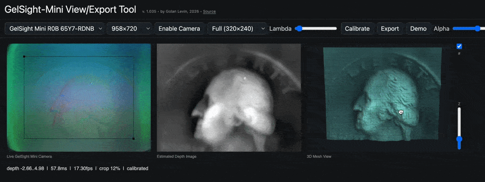
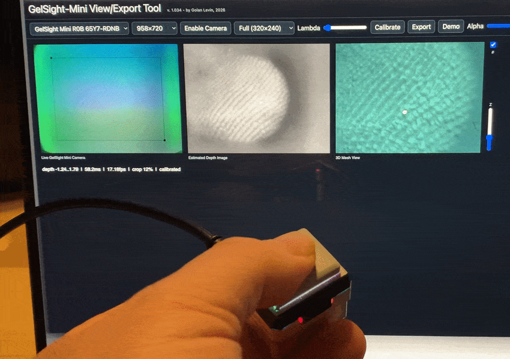
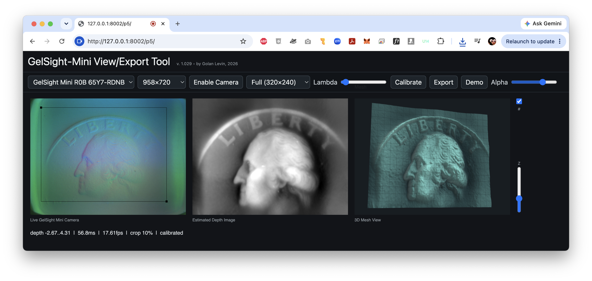

# GelSight Material Studio — experiments and process

This project explores how a GelSight Mini capture can become an image collection,
a relative surface, an ink impression, a material, or a printable relief. It includes
the original Golan Levin browser viewer, the local Material Studio, and a separate
native Python Matrix Studio. The original `gelsight_p5/` application is preserved.

The experiment record below describes the work developed in this project through
**October 8, 2026**. It distinguishes saved capture collections and completed exports
from implemented workflows checked with synthetic inputs. It does not imply that
every workflow has been physically tested on the sensor or printed.

## Start here

| What you want to do | Where to start |
| --- | --- |
| Read about the experiments and their process | [Experiment record](#experiment-record) |
| Capture rows in a native Windows application | [Matrix Studio launch and guide](#native-windows-application--row-by-row-surface-capture) |
| Capture complete RGB/depth/normal/mesh samples in the browser | [Open Studio](#open-studio-on-windows), then **08 p5 Live Capture** |
| Compare captures with ShuffleSnap | **07 Live Typology**; [capture and comparison guide](docs/mini-typology.md) |
| Find the completed all-collection exports | [Local results index](desktop-data/typology-export-20261008-all/RESULTS.md) |
| Rebuild large typologies and reliefs | [Batch export commands and formats](#export-all-collections-as-high-resolution-typologies-and-reliefs) |
| Browse labeled 0–11 panels from the supplied GelSight ZIP | [Private archive gallery](desktop-data/gel-sight-archive-study-20261008/gallery.html), [export instructions](#labeled-gelsight-archive-panels-and-motion-studies) |
| Check scientific limits and recorded validation | [Validation log](docs/studio-validation.md), [working decisions](AGENTS.md) |

The local results link requires this computer's generated data; those private files
are not included in a fresh Git checkout. Detailed operating instructions follow
the experiment record.

## Experiment record

### 1. Establishing a live Mini capture workflow

**Question:** How can the connected Mini provide a reliable live image and a
repeatable starting point for later surface experiments?

**Process:** Select the device by its GelSight name, connect its video feed, set
the capture resolution, and inspect the live RGB. Capture an explicitly untouched
reference before pressing a surface against the gel. In p5 and Matrix Studio,
calibration averages 50 distinct frames. Recalibrate when the acquisition setup
changes. The default working crop removes 10% from each edge once, keeping the
central 80% in width and height.

**Recorded outcome:** Browser Mini video was verified at 640×480. Native capture
required the FFmpeg DirectShow fallback on this computer; its advertised input
mode is recorded separately from the resized RGB delivered to the application.
The native **Live GelSight** tab remains independent of saved capture inspection.
Untouched-reference subtraction removes a background; it does not establish a
millimeter scale. See [the native acquisition process](docs/desktop-studio.md).

### 2. Turning one contact into synchronized surface assets

**Question:** Can one saved contact keep RGB, depth, normals and geometry associated
with the same source rather than becoming unrelated screenshots?

**Process:** In **p5 Live Capture**, configure the camera and inference quality,
calibrate, make steady contact, name the sample, and save the complete bundle.
The saved float depth drives the normal maps and actual OBJ geometry. Full RGB,
crop bounds, baseline references and processing settings remain traceable. Native
Matrix Studio also creates a surface PLY and point cloud for every saved cell.

**Outputs and status:** Complete p5 and native capture collections are present
locally. The p5 bundle contains RGB, float/display depth, OpenGL/DirectX normals,
an OBJ and a separate mesh screenshot. Numerical tests check their correspondence.
Increasing camera resolution preserves more RGB detail; the model depth grid stays
320×240. The display Z slider changes the preview, not exported solver values.
The browser **Capture RGB only** shortcut does not run synchronous depth inference.

### 3. Removing the untouched background and handling damaged gel

**Question:** Which fixed sensor marks can be offset, and which regions must remain
unknown because the gel is permanently damaged?

**Process:** Save an untouched reference. For p5 captures, compare model-input RGB
with the averaged reference to create an absolute-difference image and a transparent
contact view. Adjust the clear-background threshold and inspect what it removes.
For the reported permanent puncture, load the reference in the browser damage
panel, mark the hole and disturbed rim, then apply the exclusions before capturing.

**Outputs and status:** Background-difference and clean-contact modes are implemented
and checked. The damage workflow was added October 8 and tested with synthetic
camera/reference inputs; no real puncture location was guessed or physically
validated by those tests. Future marked captures exclude the region from saved
surfaces and normals, while preserving originals. The damage editor is currently
in browser Live Typology/p5, not native Matrix Studio or Video Capture. It cannot
recover missing measurements, and the original p5 live mesh screenshot is unmasked.

### 4. Comparing captures as ShuffleSnap typologies

**Question:** What relationships become visible when many tactile images are
arranged by texture similarity?

**Process:** Choose a collection in **Live Typology**, select the captures, and
choose texture or appearance comparison. Image descriptors are projected into two
dimensions using PCA. The actual pinned ShuffleSnap 0.3.0 solver assigns distinct
grid cells. Save the assignment once, then use those same cells for the RGB, depth,
normal and available mesh-view sheets. Compare labeled and image-only exports.

**Outputs and status:** The project has saved sensor collections and completed
ShuffleSnap batch boards. Boards retain source IDs/hashes, descriptors, projection
and solver settings. Baselines and synthetic examples are excluded by default.
A nearby cell means visual similarity, not measured physical adjacency, a material
classification, or proof that the surfaces can be registered.

### 5. Making depth, normals and geometry from a typology layout

**Question:** Can the image arrangement also become an arrangement of actual relief?

**Process:** Open a saved board's surface views, or create a new surface-view
revision for an older board. Reuse its frozen ShuffleSnap cells and linked depth
patches. Inspect combined depth, OpenGL/DirectX normals and the actual assembled
mesh. Compare separate components with the optional artistic seam connection.

**Outputs and status:** Implemented and numerically/browser tested. Normal maps
derive from the assembled float height at its recorded XY/Z scale. The default
keeps independent scans separate; the optional connected version records synthetic
seams. Missing depth is not replaced with a fabricated capture-time mesh view.
The larger flat-filled batch in experiment 9 is a separate export path.

### 6. Recording video and extracting a sample sequence

**Question:** Can a continuous tactile recording become a set of individually
inspectable samples?

**Process:** In **Video Capture**, connect the named Mini, optionally save an
untouched reference, and explicitly start/stop recording. Review the video, choose
an extraction interval and photo limit, then run FFmpeg extraction. Reconstruct
accepted frames offline and compare the resulting collection in Live Typology.

**Outputs and status:** The implemented workflow was checked using a synthetic
camera/video fixture, including start/stop, extraction, cancellation and asset
delivery. The original video, frame indices and timestamps are retained. Successful
frames receive aligned cropped RGB, depth, normals and OBJ geometry; rejected frames
keep their RGB and reason. This is offline reconstruction, not recorded live p5
depth. A hardware-video experiment is not claimed by the synthetic test evidence.

### 7. Capturing a surface as a native row-and-column matrix

**Question:** Can deliberate acquisition order provide a useful neighborhood
structure for studying a larger surface?

**Process:** Open the Python Matrix Studio and calibrate with no contact. Use
**Capture cell →**, move along the surface with overlap, and repeat. Use
**Next row ↙**, physically return to the left edge, and begin the next row at
column zero. Rows can have different lengths. Inspect saved RGB/depth/normal maps,
surface geometry and point clouds without replacing the live camera tab.

**Recorded collections:** The October 8 export snapshot contains four native
projects with **10, 20, 18 and 45 captures**. The highlighted 45-capture project,
`collection-20261008-131650-1ca942`, has row lengths **8, 7, 7, 7, 7, 5, 4**.
These are counts from saved project records, not a claim of independently measured
scan spacing, applied force or reconstruction accuracy.

### 8. Comparing physical-overlap registration with continuous matrix assembly

**Question:** When should nearby scans be aligned, and how should uncertain joins
or short rows be represented?

**Process:** For the **Tactile Atlas**, supply overlapping patches, reconstruct
available relief, inspect accepted/rejected registration links and retain separate
islands when alignment is unsupported. In the **native matrix assembler**, use
only existing right/down neighbors, match normal-map features, and review the
translation fit. Rejected links fall back to recorded grid priors. Overlap depth
is leveled/blended, then final normals are derived from that fused field.

**Outputs and limits:** Both paths have controlled numerical tests; the native
ragged-row workflow also has a synthetic GUI check. Atlas islands are not silently
joined. Native matrix assembly fills a rectangular extent using nearby observed
values and smoothing, marking those regions synthetic. **That differs from the
batch export below, which fills empty areas with zero-height flatness.** Neither
an attractive seam nor the matrix index establishes verified physical topology.

### 9. Constructing the high-resolution all-collection composition

**Question:** Can all saved sensor collections become both individual typologies
and one large, continuous flat-filled relief?

**Process:** Snapshot indexed native captures and nonsynthetic browser sensor
sessions. Exclude untouched references, fixtures and legacy non-sensor imports.
Reuse saved depths; reconstruct RGB-only frames offline. Run ShuffleSnap for each
multi-image collection and for the combined selection. Preserve each depth grid,
place it on the common canvas, taper an eight-pixel inside rim to zero, and leave
gaps flat. Derive the normal maps and a closed solid from that same constructed
height field. Validate serialized edges, winding, volume and the STL reload.

**Completed October 8, 2026:** **240 captures across eight collections**, exported
as eight individual sets plus one combined set. The combined RGB panorama is
**14,528×14,068**; height and normals are **4,540×4,396**; the closed mesh contains
**39,951,414 triangles**. All nine meshes passed the recorded topology/export checks.
The background batch produced about **7.4 GB** of private files.

Of the 108 RGB-only frames reconstructed for this batch, 27 used an explicit saved
reference and 81 had no reference, so no baseline was subtracted from those 81.
Original relative heights, synthetic masks and per-source deformation errors are
preserved. The 300 mm width and 5 mm relief span are authored design dimensions,
not measured sensor dimensions. These are similarity compositions, not registered
physical panoramas. [Open the local results](desktop-data/typology-export-20261008-all/RESULTS.md)
or use the [batch process and commands](#export-all-collections-as-high-resolution-typologies-and-reliefs).

### 10. Separating texture regions and proposing an unfolding

**Question:** Can related texture fragments form a new flat composition, and how
does that composition look when wrapped onto a sphere?

**Process:** In the separate **Texture Unfolding** workspace, select samples, choose
the number of groups and a repeatable seed, then assemble. Inspect connected texture
regions, the proposed rotated neighbors, the flat image, flat relief mesh and
wrapped ball. Review excluded fragments and source coverage before exporting.

**Outputs and status:** Implemented with synthetic numerical/browser validation.
Exports retain regions, rotations, neighbor scores, sources and masks. Linked depth
provides relative relief; RGB without depth stays flat. This is an appearance-based
composition, not a geometric unfolding of a recovered object. Sphere wrapping is
a UV projection with seam and pole distortion.

### 11. Developing gyotaku-inspired impressions and a texture dictionary

**Question:** How can recorded relief become a reproducible ink impression while
remaining connected to its source specimen?

**Process:** Collect a surface in **Texture Dictionary**, then develop an impression.
Choose a palette/presentation, crop and rotate the source, set virtual printing
pressure, and compare contact coverage. Make a pressure proof at 0.25, 0.55 and
0.85. Save a variant with its seed, engine version and page layout; restore that
recipe to reproduce it or compare another variation.

**Recorded work:** Local coin studies and pressure-proof exports were generated
from the provided tactile scan. Engine 2 and recipe replay have numerical/browser
checks. Outputs include a master print, transparent ink, coverage, artistic layers
and recipe metadata. Virtual printing pressure changes the artistic impression;
it is not measured sensor force and does not alter source geometry. The separate
public dictionary was deployed empty, and specimens remain private unless explicitly
approved. See [the impression process](docs/studio.md#developing-gyotaku-inspired-prints).

### 12. Turning surfaces into materials, brushes and printable reliefs

**Question:** How does a tactile sample behave as a drawn mark, a shaded material,
or a displaced object rather than an image alone?

**Process:** In **Brush & Material Lab**, derive a crop/filter or explicitly artistic
seamless variant, test brush strokes, and compare flat/sphere previews. Distinguish
normal-map shading on a flat surface from actual displacement. In **Print Studio**,
choose the relief shape, authored dimensions, backing and fidelity constraints;
inspect the mesh and validation before exporting STL/3MF. The native workflow also
provides a flat normal-textured GLB and full-grid closed STL output.

**Outputs and status:** Brush drawing/export, material previews, relief tiles,
comparison coupons and STL/3MF reloads have computational checks. The large batch
adds actual colored PLY and STL solids. Gallery exports can package selected
materials for viewing without the backend. Adding the same normal relief to a
fully displaced surface can count it twice. Digital topology checks do not replace
printer, slicer or physical print testing; those are not claimed as completed.

## Shared process and how to read the results

The recurring workflow is **capture → preserve → reconstruct → compare → compose
→ export → validate**. Full source uploads stay immutable and hashed. Derived
versions retain their source, crop, processing settings and units; later calibration
or an artistic edit does not rewrite earlier captures.

RGB records the gel's illuminated appearance. Float depth records relative relief.
Normal maps describe surface direction at a stated XY/Z scale. Meshes and point
clouds carry geometry; a mesh screenshot is only a view. A gray depth PNG needs its
recorded encoding to recover numbers. Empty, excluded and synthesized pixels must
be interpreted using the accompanying masks. OpenGL normals use Y up; DirectX
flips green. Neither a sharper RGB image nor an authored millimeter export turns
the Mini's relative inference into a measured calibration.

To repeat an experiment, record the collection/sample IDs, device and baseline,
crop, model/solver, layout or seed, output scale, and observed limitations. Change
one setting at a time and save a new derived version. Compare source detail and
synthetic masks as well as the rendered appearance. The latest recorded full suite
has **69 passing tests**, plus the example generator, Studio browser smoke and
original p5 regression; dates and qualifications live in the
[validation log](docs/studio-validation.md).

## Native Windows application — row-by-row surface capture

Double-click **[Start-Desktop-Studio.cmd](Start-Desktop-Studio.cmd)** to open the
separate Python/Qt application. It uses a native window and 3D viewport, with no
HTML, browser or web server. Dependencies are installed on this computer.

```powershell
cd "C:\Users\Jeffr\OneDrive\Documents\GitHub\gelsight-mini-browser-tool"
.\start-desktop.ps1
```

On a new computer run `.\start-desktop.ps1 -Setup` once. Connect the named Mini,
calibrate with the gel untouched, then use **Capture cell →** and **Next row ↙**.
The **Live GelSight** tab shows the current camera image independently of the
saved images in **Captured maps**, including while adding cells to the matrix.
Each cell saves RGB, cropped depth, normals, a mesh and point cloud. Unequal row
lengths are supported. Build RGB/depth/normal panoramas, inspect the native 3D views,
adjust relief depth, and export a closed STL solid. Normal-map texture baking is
also included. The central 80% is used once for all surface outputs.

See **[the desktop guide](docs/desktop-studio.md)** for configuration comparison
with Golan's code, every mode, file formats, calibration, stitching and printing.
Depth is relative; forced joins and missing-cell fills are marked synthetic.
Digital solid validation does not replace printer/slicer or physical validation.

## Material Studio and Texture Dictionary

### Permanent mark or puncture in the gel

In browser **Live Typology**, lift the Mini clear of contact and click **Save
no-contact baseline**. In **p5 Live Capture**, instead click **Calibrate** and wait
for 50 frames. Then use the **Startup: permanent gel damage** panel: **Load untouched
reference**, click the puncture and its rim, adjust the mark radius if needed, and
click **Use marked exclusions**. Apply changes again after editing marks.

New captures preserve the original RGB and exclude marked damage from reconstructed
surface geometry and normal maps. Quick capture still saves RGB only until you
reconstruct it; p5 saves the complete bundle. The mask cannot recover measurements
from damaged gel. p5 live views remain diagnostic; the saved OBJ and validity masks
are the corrected outputs. This startup panel is in the browser Studio, not the
native Matrix Studio. See [the detailed capture guide](docs/mini-typology.md).

The new [Material Studio guide](docs/studio.md) covers the local capture, atlas,
material/brush, print, gallery and specimen workflows. Start with
`./start-studio.ps1` after its one-time setup, then open http://127.0.0.1:8090.
The original viewer below is preserved. Important implementation and publication
decisions are tracked in [AGENTS.md](AGENTS.md); verification is recorded in
[studio-validation.md](docs/studio-validation.md). The public collection is empty
by owner request; example captures remain local drafts.

For the connected Mini and image typologies, double-click
**[Start-Material-Studio.cmd](Start-Material-Studio.cmd)**. It opens a dedicated
Chrome window with the Mini connected and **p5 Live Capture** ready.
Capture named RGB/depth/normal/mesh bundles, then use **Live Typology** to compare them using the actual
[ShuffleSnap](https://github.com/kylemcdonald/shufflesnap) package.
See [the capture and typology guide](docs/mini-typology.md). Everything remains local.

### Open Studio on Windows

Open **PowerShell**, paste these commands, and press Enter:

```powershell
cd "C:\Users\Jeffr\OneDrive\Documents\GitHub\gelsight-mini-browser-tool"
.\start-studio.ps1 -OpenBrowser
```

This starts the local server if needed and opens the dedicated Chrome window for
the GelSight Mini. You can also double-click **Start-Material-Studio.cmd** in the
project folder. Keep the Mini plugged in and close any other app using its camera.
If Studio is already running, use its existing Chrome window and refresh it after
an update. Open **08 p5 Live Capture** to save all capture assets together.

For a server without opening Chrome, run this instead (keep PowerShell open):

```powershell
cd "C:\Users\Jeffr\OneDrive\Documents\GitHub\gelsight-mini-browser-tool"
.\.venv-studio\Scripts\python.exe -m studio serve --port 8090
```

Then visit http://127.0.0.1:8090. Stop that foreground server with **Ctrl+C**.
Use the dedicated Chrome launcher above for the configured camera permission.
Do not start a second server if port 8090 is already running Studio.

Only for a **fresh installation**, install Python 3.11, Node.js 20+ and Chrome,
then run this once from the project folder before the launch command:

```powershell
py -3.11 -m venv .venv-studio
.\.venv-studio\Scripts\python.exe -m pip install -r requirements-studio.txt
npm ci
npm run setup:web
```

### All Studio modes

| Mode | Function and workflow |
| --- | --- |
| 01 Surface Capture | Import RGB, height, normal maps, meshes, sequences or p5 ZIPs. Select background/calibration, reconstruct, and inspect height, masks and normals. |
| 02 Tactile Atlas | Register overlapping patches; review accepted/rejected links and separate islands. Similar appearance alone does not establish a verified join. |
| 03 Brush & Material Lab | Derive crops, filters and seamless artistic variants; make image brushes, draw strokes, preview flat/sphere materials and export maps. |
| 04 Print Studio | Bake relief into tiles, curved swatches, spheres or coupons. Supply dimensions or validated metric data, inspect geometric validation and export STL/3MF. Slicer/physical tests are separate. |
| 05 Material Gallery | Compare saved materials; export a backend-free gallery containing only selected assets. |
| 06 Texture Dictionary | Collect specimens, make reproducible gyotaku-inspired prints and pressure proofs, choose covers and public snapshots. Public specimens require explicit selection; the public collection remains empty. |
| 07 Live Typology | Quick RGB-only capture and ShuffleSnap comparison grids; coordinated raw/depth/normal/mesh/clear-background sheets, actual assembled 3D relief, combined depth and normal maps in the same layout. |
| 08 p5 Live Capture | Embedded original p5 acquisition, controls, live depth and mesh. Calibrate without contact, name a sample and save all views together. |
| 09 Texture Unfolding | Separate program at `/unfold`: segment textures, propose neighboring regions, inspect a flat image, flat 3D mesh and wrapped ball. Joins are inferred artistic arrangements. |
| 10 Video Capture | Live Mini video with Start/Stop, playback and private original storage. FFmpeg extracts photos, then offline reconstruction generates associated cropped depth, normal maps and actual OBJ meshes. |

### Record video and extract complete samples

Launch Studio with the commands above, then open **10 Video Capture** (or
http://127.0.0.1:8090/#video). FFmpeg must be installed and available on `PATH`;
check with `ffmpeg -version` in PowerShell. On this machine it is installed in
`C:\FFmpeg\bin`. Restart Studio after changing `PATH`.

1. Select the named GelSight Mini, choose a resolution and click **Connect Mini**.
   The preview is live; saving starts only when you click **Start recording**.
2. Optionally lift clear of contact and click **Save untouched reference** before
   recording. This explicit reference supports background subtraction in offline
   reconstruction; it does not calibrate millimeters. Reconnecting clears it.
3. Click **Start recording**, move between surfaces, then **Stop recording**.
   Recording stops automatically at 10 minutes or approximately 120 MiB. Audio is
   not recorded. You can play back or download the stopped video. Leaving the mode
   stops the camera; the stopped recording stays in this browser tab until upload,
   replacement or closing/reloading the tab.
4. Choose **Extract every Nth frame** and **Maximum photos**, then click
   **Extract frames + depth + normals + mesh**. For example, every 10th frame of
   30 fps video gives about three photos per second. The default cap of 60 photos
   covers about 20 seconds in that example; increase the interval for longer takes.
5. FFmpeg decodes the first 10 minutes, extracting up to 120 selected photos per
   job. Large frames are reduced to fit 1280 × 960 without stretching. The uploaded
   video remains immutable. Each extracted full frame is preserved separately.
6. Every successful sample gets cropped RGB, a depth PNG and float depth, OpenGL/
   DirectX normal maps, float normals, validity masks and an actual `mesh.obj`.
   **All cover the same central 80% in X/Y: remove 10% from each edge once, before
   depth reconstruction.** Normals and mesh derive from that cropped depth, so
   they are not cropped a second time. Output pixel dimensions depend on the
   bounded reconstruction grid; the field of view stays aligned.
7. Review the extracted collection and download RGB/depth/normal/OBJ assets.
   Choose its session in **Live Typology** to build comparison sheets. Saved
   recordings can be played back and reprocessed with a different interval;
   each extraction creates a new collection. Use **Cancel** in the job panel to
   stop processing. Already saved photos remain available; an incomplete run is
   not labeled completed.

Video frames use the bundled Mini model and Studio's **offline masked Poisson
solver**, not the live p5 solver, temporal smoothing or capture-time depth.
Results are relative relief, not millimeters. Bad/blurred/non-contact frames may
be rejected; their RGB remains with the reason, and missing depth is not fabricated.
No live mesh screenshot is invented for an extracted frame. OBJ is actual geometry.
Each run's manifest records the video hash, FFmpeg version, frame indices,
timestamps, crop, limits and associated sample IDs. Uploads are capped at 128 MiB.
Everything stays local; recording does not publish dictionary specimens.

### Live capture, depth and sensor calibration

The embedded viewer uses the bundled Golan Levin app itself; `/gelsight_p5/`
remains unchanged. **Camera resolution** offers 640×480, 958×720, 1640×1232 and
3280×2464. These are requested modes; actual negotiated dimensions are recorded.
**Fast** infers at 160×120 then upsamples slopes; **Full** infers at 320×240.
Both produce a **320×240 depth grid**. More camera pixels do not add model detail.

1. Open `Start-Material-Studio.cmd`. The dedicated Chrome profile selects a named
   GelSight only. Close another live feed before connecting here.
2. Set resolution and Fast/Full quality. The default crop removes **10% from each
   edge**, keeping the central 80% of both dimensions. Drag the original crop
   handles to override it, or use **Restore 10% edge crop**. The actual crop is
   recorded; full originals remain immutable.
3. Lift clear of contact, press **Calibrate**, and wait for **50 distinct frames**.
   This averages and subtracts the no-contact background. Recalibrate after
   changing crop, camera resolution, inference quality or Lambda. Studio rejects
   sample bundles while calibration is unfinished or stale.
4. Make steady contact. **Lambda** adjusts Poisson regularization; **Alpha** adjusts
   temporal input smoothing. **Z** exaggerates displayed mesh height and **#**
   switches interpolation. Drag to orbit/pan, scroll to zoom, double-click to reset.
5. Name the sample and **Save RGB + depth + normals + 3D mesh**. Cropped RGB,
   float solver depth, baseline if available, depth display, mesh screenshot and
   view settings are frozen from the same processing result. Smoothing can include
   previous frames. The screenshot retains your camera/Z settings; numerical
   height does not include display exaggeration. Studio automatically derives
   OpenGL/DirectX normal maps and an actual OBJ mesh from that frozen depth.
   Download links appear directly below the save status.
6. In **Live Typology**, select these RGB captures and build once. Download the
   named contact sheet, plus **raw**, **depth**, **normal** and **mesh** sheets, each with or
   without names. Every sheet uses identical cells. Here raw means cropped RGB;
   full originals stay local. Older missing views say “Not captured.” Long PNG
   names wrap/truncate; HTML and JSON retain full names.

Each new p5 capture has a single sample record linking all these files:

| File | Contents |
| --- | --- |
| `raw.png` | Cropped RGB; the full original remains separately preserved. |
| `depth.npy` / `depth.png` | Float relative solver depth / grayscale preview. |
| `normal.png` / `normal-directx.png` | OpenGL (+Y) / DirectX (−Y) normal maps, derived from saved depth. Import as non-color data. |
| `normals.npy` | Float OpenGL unit normals, shape 240 × 320 × 3. |
| `mesh.obj` | Actual open relief surface from the same depth grid; an unmasked full grid has 76,800 vertices and 152,482 triangles. Damage exclusions reduce these counts. |
| `mesh.png` | Screenshot of the chosen p5 mesh camera view. |
| `sample.json` | Source references, crop, capture settings and asset/coordinate definitions. |

The per-capture OBJ uses unit model-pixel XY spacing and unchanged solver Z values,
with Y up. Normals use the same scale. These are relative coordinates, not mm;
the OBJ is an open surface, not a print-ready solid. Display Z exaggeration changes
the screenshot only. Typology assembly maps use their separately recorded display
scale. Saved-board tiles also offer individual sample download links when available.
Older captures are not silently rewritten.

**Use p5 Live Capture for the complete bundle.** The explicitly labeled
**Capture RGB only** shortcut in Live Typology remains an image-only capture;
it cannot save synchronous depth from a model it is not running.

**Actual 3D stitching and combined depth:** below a saved board, switch between
**Stitched 3D meshes** and **Combined depth map**. The first assembles real source
height geometry at the ShuffleSnap positions; it is more than a screenshot
collage. Orbit/zoom and enable wireframe. Download the actual OBJ, depth PNG or
floating-point depth/mask NPZ. For older boards, **Build 3D / depth / normal views from this
layout** creates a new revision without moving any cells. RGB-only captures need
a reconstructed patch first; missing depth remains empty. Existing p5 bundles
use their captured depth; older RGB frames use their latest linked reconstruction.
The manifest records precisely which source/version was used.

Each scan remains a separate component; adjacency in ShuffleSnap is visual
similarity, not physical overlap. No triangles bridge missing cells or independent
scan boundaries. OBJ coordinates use authored display scale, not millimeters.
Enable **Connect neighboring tiles with artistic seams** to bridge the facing
edges without moving the captured vertices. The combined depth view then shows
interpolated gaps. Connected OBJ/depth/NPZ exports are separate; the OBJ names its
synthetic face group and NPZ includes source/synthetic masks. These bridges are
invented connections for display, never evidence that two scans physically join.
NPY/NPZ preserve assembled height values (resampled to a bounded preview grid) and
mask. If metric and relative sources are mixed, heights are explicitly normalized
per source and labeled accordingly. Source arrays remain unchanged.

**Normal map mode:** click **Normal map** under the surface assembly. Choose
**OpenGL (+Y)** or **DirectX (−Y)**; DirectX reverses the green channel. The seam
checkbox switches this preview between separate scans and artistic connections.
Download either convention as a PNG, its validity mask, or floating-point OpenGL
unit normals and masks in NPZ. The private board ZIP includes all versions.
Normals derive from floating-point depth using the assembly's authored XY/Z
display scale, not from the grayscale PNG or a metric calibration. Separate-scan
derivatives never cross tile boundaries or holes. Connected maps derive from the
interpolated depth raster, so they are not exact OBJ triangle normals; their NPZ
also marks normals changed by the synthetic seams, including source-edge pixels.
Neutral blue `(128,128,255)` fills invalid pixels; use the normal mask to exclude
them. Import PNGs as **non-color/linear data** in a material editor and choose its
matching convention. Use them to shade a flat surface; adding the same normal
relief to fully displaced geometry can count that relief twice. Existing boards
gain these files through the new-revision button above; their originals stay intact.

**Clear-background and subtraction modes:** when you calibrate in p5 Live Capture,
Studio also averages the RGB model input over those same 50 no-contact frames.
New live samples save **clean.png** (original model-input color with transparent
background) and **difference.png** (absolute RGB difference, displayed at 3× gain).
The **Clear-background threshold** sets the RGB-difference norm needed to retain
a pixel; a small morphological opening suppresses noise. Lower values retain
faint changes; higher values remove more background. Preview these links after
saving, or download the **clean** and **difference** typology sheets with/without
names. These are visual contact masks, not object photographs or force measurements.
An old/demo sample without the matching RGB reference is marked unavailable;
no background is guessed. Recalibrate in the embedded live viewer to obtain one.
Numerical p5 depth already subtracts its depth background: it is never subtracted
twice. Bundles also retain `depth-before-background.npy = depth + baseline` when
a baseline exists, plus the baseline itself, for direct comparison.

The depth image is normalized grayscale, **not millimeters**. Saved sample
`depth.npy` contains floating-point solver values. The original p5 **Export**
still produces its ZIP with RGB, 16-bit display/solver depth, baseline, OBJ and
metadata; an optional high-resolution still is a later, non-synchronous grab.
**Demo** loads the bundled coin; saved demo bundles are labeled and excluded from
ordinary typologies by default.

**Metric calibration is separate.** Surface Capture accepts profiles with actual
sensor/gel IDs, exact input/crop dimensions, model, XY spacing in mm and independent
validation notes. The bundled Mini model and no-contact background alone cannot
establish metric accuracy. Match the calibration optical/crop setup to acquisition;
see [Studio calibration and formats](docs/studio.md) for adapters and training.

### Separate Texture Unfolding program

Open [Texture Unfolding locally](http://127.0.0.1:8090/unfold) while Studio runs.
It has its own page, selections, jobs and saved assemblies. Choose 1–32 RGB frames
or patches, one input per sample. Linked p5 RGB brings its depth automatically;
ordinary RGB stays flat. Choose 2–8 groups and a repeatable seed, then assemble.

The program clusters color, local contrast and directional gradients; extracts
connected regions; and proposes neighbors using texture groups and facing-edge
appearance/contour scores, trying 90-degree rotations. It retains larger regions
and reports excluded fragments and source coverage. **Separated regions** shows
cluster maps; **Flat image** shows the assembly; **Flat 3D mesh** preserves masked
holes and displays relative relief; **Wrapped ball** maps the whole image once,
with gaps, seam and pole distortion visible. Available depth is normalized per
source for display. Adjust relief strength or show wireframe.

This is an **inferred composition**, not recovered object topology or a geometric
unfolding of an observed closed mesh. Use Tactile Atlas for verified scan overlap.
Download the PNG or private ZIP with height/masks, region IDs, source previews,
hashes, crop references, region boxes, rotations, neighbors and scores. Assemblies
never become calibrated patches or enter the public dictionary automatically.
CLI: `python -m studio run --kind unfold --config unfolding.json`, with JSON fields
`items` (list of `{ "kind": "frames", "id": "…" }`), `name`, and
`settings` (`groups`, `columns`, `seed`).

## Original GelSight-Mini viewer

The following reference describes the original browser viewer. Use the Studio
sections above for the added experiments, workflows and interpretation of outputs.

> This is a browser-based tool for viewing, reconstructing, and exporting data
from a [GelSight Mini](https://www.gelsight.com/products/gelsightmini/) tactile sensor. This work was created by Golan Levin at CMU's Frank-Ratchye STUDIO for Creative Inquiry, August 2026.



#### Quick Links

* [**Purchase** a GelSight Mini](https://www.gelsight.com/product/gelsight-mini-system/) (~\$500-600)
* [**Test** the GelSight Mini browser tool, online](https://golanlevin.github.io/gelsight_p5/)
* [**View** a brief YouTube tutorial here](https://www.youtube.com/watch?v=4apYlLzpnoo)
* [**Read** the technical documentation here](technical_information_js.md)
* [**Watch** Steve Mould's video about GelSight](https://www.youtube.com/watch?v=qtQ4rK66vlE)

---

## Overview

> The GelSight family of tactile sensors are vision-based touch sensors that transform physical contact into high-resolution 3D measurements of surface geometry. Rather than relying on arrays of pressure sensors, a GelSight device contains a soft, transparent elastomer coated with a reflective membrane; when pressed against an object, the gel conforms to its microscopic topography, and an internal camera with colored LED illumination images the resulting deformation. Using photometric stereo, the system reconstructs a micron-scale 3D height map. Because the sensing process depends on geometry rather than optical appearance, GelSight can accurately inspect opaque, reflective, transparent, or textured materials with sub-micron depth sensitivity.

The [GelSight Mini](https://www.gelsight.com/products/gelsightmini/) is a [\$510 tactile sensor](https://www.gelsight.com/product/gelsight-mini-system/) which presents to the computer as a standard UVC webcam. The browser captures its live video stream, estimates a depth map from the colored tactile image, displays a 3D mesh preview, and exports captures as ZIP files containing images, depth maps, OBJ meshes, calibration data, and metadata.


---

## What You Need

- A GelSight Mini tactile sensor connected by USB.
- A recent desktop browser. Chrome is recommended.
- A local web server. The browser camera API works from `localhost`.

--- 

## First-Time Setup

If you wish, you can test the software online, at this URL: 

> [https://golanlevin.github.io/gelsight_p5/](https://golanlevin.github.io/gelsight_p5/)

***Alternatively***, you can run the software locally. Download or clone this repository, then start a local web server from the top-level project folder:

```sh
python3 -m http.server 8002
```

Then open this local web server URL in Chrome:

```text
http://127.0.0.1:8002/gelsight_p5/
```

Do not open `index.html` by double-clicking it. Browser camera access and local
WASM/model loading are more reliable from `http://localhost` than from a
`file://` URL.

---

## How To Use The Tool



1. Plug in the GelSight Mini.
2. Open the software tool in the browser, either served locally (`http://127.0.0.1:8002/gelsight_p5/`) as described above, or on this page: [https://golanlevin.github.io/gelsight_p5/](https://golanlevin.github.io/gelsight_p5/). *Note: all captures made on that page remain local to your machine.*
3. Choose the GelSight Mini from the Camera menu.
4. Choose a capture resolution. The default is intended to balance quality and
   speed.
5. Click `Enable Camera` and allow browser camera access if prompted.
6. Optionally, adjust the crop rectangle over the useful part of the GelSight image.
7. With nothing touching the gel surface, click `Calibrate`.
8. Wait for calibration to finish. Do not touch the sensor while it says
   `CALIBRATING`.
9. Press an object into the GelSight surface. The tool will show:
   - the live GelSight camera image
   - an estimated depth image
   - a 3D mesh preview
10. Use the controls as needed:
    - `Fast (160x120)` / `Full (320x240)` changes inference quality.
    - `Lambda` adjusts Poisson integration regularization.
    - `Alpha` adjusts temporal smoothing.
    - The vertical `Z` slider changes only the 3D preview scale.
11. If the `Calibrate` button pulses, recalibrate before trusting measurements. Changes such as crop or lambda can make the current calibration stale.
12. Click `Export` to save a ZIP file. This contains the exported files listed below. 

---

## Exported Files

Exports are named like:

```text
gelsight_YYYYMMDD_HHMMSS.zip
```

The ZIP can include:

- `capture.png`: the image used to compute the depth map and mesh.
- `capture_highres.jpg`: optional high-resolution camera grab.
- `depth_16bit.png`: normalized 16-bit depth image.
- `depth_solver_units_16bit.png`: fixed-range solver-unit depth image.
- `baseline_16bit.png`: calibration baseline, when available.
- `mesh.obj`: exported 3D mesh.
- `metadata.json`: capture, calibration, processing, and export metadata.

---

## Demo Mode



The `Demo` button loads a sample export from `gelsight_p5/captures/`, a scan of a US coin. This is
useful for trying the interface without a connected sensor. When Demo mode is
active, the button changes to `Live`; click it to return to the camera.

## Notes

- The depth values are solver units, not calibrated millimeters.
- For best results, recalibrate after changing crop, lambda, inference quality,
  capture resolution, or sensor lighting/contact conditions.
- The 3D preview scale does not affect the exported OBJ.
- Technical implementation notes are in `technical_information_js.md`.
- A possible TouchDesigner roadmap is in `technical_information_td.md`.

## Export all collections as high-resolution typologies and reliefs

From the repository folder in PowerShell, run:

```powershell
.\.venv-studio\Scripts\python.exe -m studio.collection_export
```

This creates a new private `desktop-data/typology-export-*` folder. It snapshots
every indexed native collection and nonsynthetic browser sensor collection,
excludes baseline references/test fixtures, and creates a ShuffleSnap arrangement
per collection plus `ALL-COLLECTIONS`. Originals and existing Studio boards remain
unchanged. A collection containing one image is placed directly without a solver.

Each result contains:

| File | Purpose |
| --- | --- |
| `rgb-panorama.png` | Large RGB mosaic using available cropped source detail. |
| `typology-labeled.png` | The same layout with capture names. |
| `height.npy` / `height-16bit.png` | Constructed float/16-bit height; PNG decoding is in `manifest.json`. |
| `observed-relative-height.npy` | Original source heights in the layout, with NaN outside observations. |
| `normal-opengl.png` / `normal-directx.png` / `normals.npy` | Normals derived from the constructed height at the mesh's XY/Z scale. |
| `source-mask.png` / `synthetic-mask.png` | Observed pixels versus flat fills and tapered boundaries. |
| `normal-synthetic-influence-mask.png` | Pixels whose normal neighborhood includes synthetic data. |
| `relief-closed.ply` / `relief-closed.stl` | One continuous displaced top, closed walls and bottom; PLY includes color. |
| `manifest.json` / `features.npz` | Frozen sources, hashes, grid assignment, solver settings and topology/reload validation. |
| `fidelity.json` | Per-source error from the deliberate rim taper, compared with both original and scaled heights. |

The depth grid is not reduced. RGB can have a higher resolution than depth;
resampling a smaller capture does not add measured detail. Empty areas have zero
height. An eight-pixel inside rim tapers each patch into flat space; those pixels
are marked synthetic. ShuffleSnap adjacency is visual similarity, not physical
registration. Normals describe the height field, not exact triangle face normals.

Saved native/p5 depths are reused without another crop or baseline subtraction.
RGB-only captures receive separately labeled offline CPU reconstruction using the
central 80% crop. Only explicitly saved matching references are subtracted; a
capture without a reference stays uncalibrated. Historical damage is not guessed.

Defaults are an **authored** 300 mm overall width, a 5 mm global relief span and
at least 2 mm backing. These are design dimensions, not measured sensor dimensions.
Change them with `--width-mm 600 --relief-mm 10`. Closed topology is checked, but
printer, slicer and physical print readiness require separate verification.

The batch is bounded to 32 million height samples and 256 million RGB pixels per
board. It streams large meshes and uses disk-backed validation; expect multi-GB
outputs for large collections. Ctrl+C cancels a foreground run. To resume:

```powershell
.\.venv-studio\Scripts\python.exe -m studio.collection_export --output desktop-data/typology-export-YOUR-RUN --resume
```

Resume checks source/output hashes and requires the original design dimensions.
Only a final `export-index.json` with `complete: true` confirms the whole batch.

## Labeled GelSight archive panels and motion studies

The supplied `gel_sight_data-20261008T193658Z-1-001.zip` contains **124 captures**
in five collections and thirteen panel groups. The separate private
[archive gallery](desktop-data/gel-sight-archive-study-20261008/gallery.html) labels
every collection, panel and scan. Every image layer uses this fixed arrangement:

```text
 0   1   2
 3   4   5
 6   7   8
 9  10  11
```

Human, Diffusion Policy and Stats Inferred each supply three complete panels of
twelve scans. Documentation supplies panels with 1, 3 and 3 scans; Spring supplies
one panel with 9 scans. Missing positions remain labeled **Not provided**. No
ShuffleSnap reordering is applied to these explicitly ordered boards. Folder
names and internal metadata names are both retained: Spring's internal session
name says `scan_stats_panel_irb120_200261008`.

Each panel includes labeled sheets for tactile RGB, supplied normals, supplied
height colors, supplied shear images, reference, difference, contact/marker masks,
grayscale height, derived OpenGL normals, shaded relief and perspective model
previews. Each scan keeps its original metadata, force report, float height,
gradients and displacement arrays. The uncropped originals remain in the extracted
source snapshot. There is no additional crop, baseline subtraction or inference.

Each scan has **GLB, OBJ and PLY geometry** built from every supplied depth sample.
The [labeled model bundle](desktop-data/gel-sight-archive-study-20261008/models-labeled.zip)
contains all 124 GLBs with collection, panel and scan IDs in their filenames.
OBJ/PLY use the source-declared millimeters and XY spacing; GLB uses meters. The
source declares `0.0634 mm/pixel`, but no independent physical calibration has been
verified. Positive source indentation is displayed as positive relief. Supplied
normal images remain unchanged; separate OpenGL/DirectX normals derive from the
same height and spacing as the models. Displaced models receive no extra normal
relief. The perspective preview samples every fifth pixel and exaggerates Z by
12 for visibility; exported geometry retains full resolution and original heights.

Each panel also has an authored **300 mm wide / 5 mm relief-span** closed STL/PLY
composition. Flat gaps and eight-pixel tapered rims are synthetic and explicitly
masked. Original heights remain in `board/observed-source-height.npy`, with their
source-declared units in the manifest. This composed relief is not physical
registration, and topology checks do not constitute printer or slicer validation.

Seven labeled animation variants are generated for **every scan and panel**:

- Loading: outward arrows and a reversible image deformation.
- Shear: authored lateral displacement and arrows.
- Torsion: authored rotational displacement and arrows.
- Height layers: contours and an animated relative-height band.
- Particle wave: particles sort by relative height within each cell.
- Pixel tearing: RGB tiles, including the background, separate and return.
- Layer stack: RGB, normal, height, reference, difference and supplied shear layers.

Individual outputs are GIFs; collective panel outputs include GIF and H.264 MP4.
Default videos contain 48 frames at 12 fps. GIF holds are quantized to hundredths
of a second and identical frames can be combined, so their loops last approximately
3.84–3.98 seconds. The media validation report records each GIF's actual duration.
All load motion and tearing are **artistic**:
they are not measured force histories, physical simulations or failure predictions.
Height ranking is not force ranking. Layer-stack animation is a presentation of
static layers, not a recorded time sequence.

All 124 supplied force reports contain **zero tracked markers** and **null normal
and shear force values**. The supplied shear images are retained, along with dense
flow arrays, but those arrays do not establish reliable marker tracking or force.
Source contact masks and reported indentation-volume proxies are preserved as
source outputs, without treating them as verified physical measurements.

The visual vocabulary of outward, lateral and rotational displacement is informed
by [Yuan et al., Measurement of Shear and Slip with a GelSight Tactile Sensor (2015)](https://people.csail.mit.edu/yuan_wz/GelSight1/ICRA15_2740_FI.pdf),
[Yuan, Dong and Adelson's GelSight review (2017)](https://doi.org/10.3390/s17122762),
and [Yuan's force, shear and slip project](https://people.csail.mit.edu/yuan_wz/force-shear-and-slip.htm).
Those studies use marker observations through image sequences and experimental
calibration. This exporter does not reproduce their force estimators or transfer
their material constants to this Mini.

Rebuild in a new private folder:

```powershell
.\.venv-studio\Scripts\python.exe -m studio.archive_study `
  'C:\Users\Jeffr\Downloads\gel_sight_data-20261008T193658Z-1-001.zip' `
  --output desktop-data/gel-sight-archive-study-NEW
```

Add `--resume` to the same command after an interruption. Resume verifies the
archive, extracted source hashes and completed panel assets, then regenerates only
incomplete derived panels. `manifest.json` with `complete: true` confirms the
entire export. `capture-index.csv` maps every output to its supplied labels and
source proxy values. Sources and older collections remain unchanged; nothing is
published to the public dictionary. See [recorded validation](docs/studio-validation.md).

For a separate twelve-cell selection from an older all-collection manifest:

```powershell
.\.venv-studio\Scripts\python.exe -m studio.twelve_study `
  --manifest desktop-data/typology-export-20261008-all/ALL-COLLECTIONS/manifest.json `
  --cells 0,1,2,3,4,5,6,7,8,9,10,11 --output desktop-data/twelve-study-NEW
```

## License

This project is intended to be distributed under GPL-3.0-or-later. See the [technical documentation](technical_information_js.md) for notes about redistributed GelSight-derived
model assets and third-party browser/runtime components.
